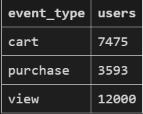
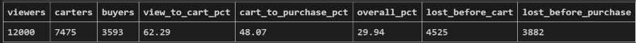
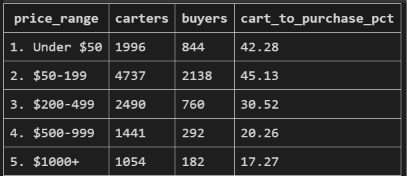
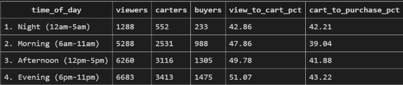
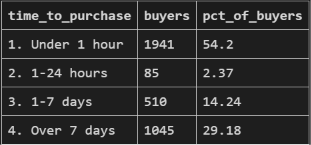

# eCommerce Funnel Analysis (SQL)

An end-to-end funnel analysis of user behavior on an online store, written in SQL. The project cleans a messy event log, measures conversion at each stage (view → cart → purchase), breaks conversion down by category, price, time of day, and time to purchase, and turns the results into business recommendations.

**Tools:** SQL (SQLite), Python (one-time data loading), VS Code

---

## Business Question

Where do customers drop out of the purchase funnel, and what can the business do about it?

## Summary of Findings

- **29.9%** of viewers go on to purchase. The biggest leak is **cart → purchase**, where **51.9%** of users who add an item to their cart never buy.
- **Price is the strongest driver of conversion.** Cart-to-purchase conversion falls from about 44% for items under $200 to about 25% above $200, and to 17% for items over $1,000.
- **High-ticket categories convert worst:** sofas (14.1%), bicycles (14.4%), TVs (17.2%), and notebooks (17.4%).
- **Time of day matters much less than price.** Cart-to-purchase varies by only about 4 points across the day, versus about 28 points across price ranges.
- **Over half of buyers (54%) purchase within an hour of their first view**, while about 29% take more than a week.

## Dataset

The dataset is **synthetic**. I generated it with `generate_data.py` to mimic the structure of the public [eCommerce Behavior Data](https://www.kaggle.com/datasets/mkechinov/ecommerce-behavior-data-from-multi-category-store) dataset on Kaggle, and I added realistic data-quality problems on purpose so the cleaning step is meaningful.

- ~151,000 events from ~12,000 users, October 2019
- Columns: `event_time`, `event_type`, `product_id`, `category_id`, `category_code`, `brand`, `price`, `user_id`, `user_session`
- Event types: `view`, `cart`, `remove_from_cart`, `purchase`

Because the data is synthetic, the specific numbers below demonstrate the method and should not be read as real-world benchmarks.

## Data Cleaning

The raw table (`events`) has known problems. `sql/00_data_cleaning.sql` builds a cleaned view (`events_clean`) that every later query uses.

| Problem | How I handled it |
|---|---|
| ~3,000 exact duplicate rows | `SELECT DISTINCT` |
| Inconsistent casing and whitespace in `brand` and `event_type` | `LOWER(TRIM(...))` |
| Mixed timestamp formats (`...T...Z` vs `... UTC`) | `REPLACE` to standardize |
| Zero and negative prices | Excluded with `price > 0` |
| Missing `user_id` | Excluded, since unidentified users can't be counted |
| 4 bot accounts with 2,500 views each and no purchases | Excluded (`user_id < 900000000`) so they don't inflate top-of-funnel counts |
| Missing `brand` and `category_code` | Kept in the funnel totals; excluded only from category breakdowns |

## Analysis and Results

### 1. Overall funnel (`01_funnel_counts.sql`, `02_conversion_rates.sql`)

| Stage | Users | Conversion from previous stage |
|---|---|---|
| View | 12,000 | n/a |
| Add to cart | 7,475 | 62.3% |
| Purchase | 3,593 | 48.1% |

- 29.9% of viewers go on to purchase.
- 51.9% of users who add to cart never buy. This is the most important leak, because these users already showed strong purchase intent.



### 2. By product category (`03_by_category.sql`)

| Category | Viewers | Carters | Buyers | Cart → Purchase |
|---|---|---|---|---|
| furniture.living_room.sofa | 4,145 | 341 | 48 | 14.08% |
| sport.bicycle | 5,929 | 651 | 94 | 14.44% |
| electronics.video.tv | 4,395 | 465 | 80 | 17.20% |
| computers.notebook | 5,558 | 753 | 131 | 17.40% |
| electronics.smartphone | 4,892 | 948 | 242 | 25.53% |
| electronics.audio.headphone | 5,519 | 973 | 275 | 28.26% |
| appliances.environment.vacuum | 4,232 | 562 | 162 | 28.83% |
| appliances.kitchen.blender | 4,598 | 813 | 274 | 33.70% |
| accessories.bag | 7,758 | 2,134 | 763 | 35.75% |
| apparel.shoes | 6,809 | 1,870 | 749 | 40.05% |
| kids.toys | 4,657 | 1,401 | 614 | 43.83% |
| apparel.tshirt | 4,526 | 1,167 | 513 | 43.96% |

- Worst: sofas (14.08%) and bicycles (14.44%). Best: t-shirts (43.96%) and toys (43.83%).
- Higher-priced categories convert at roughly a third of the rate of low-priced apparel and toys.
- Category viewer totals add up to more than 12,000 because one user can browse several categories.



### 3. By price range (`04_by_price_range.sql`)

| Price range | Carters | Buyers | Cart → Purchase |
|---|---|---|---|
| Under $50 | 1,996 | 844 | 42.28% |
| $50-199 | 4,737 | 2,138 | 45.13% |
| $200-499 | 2,490 | 760 | 30.52% |
| $500-999 | 1,441 | 292 | 20.26% |
| $1000+ | 1,054 | 182 | 17.27% |

- Conversion drops sharply at the $200 mark: roughly 44% of carters buy below it and roughly 25% above it.
- Items over $1,000 convert at about 17%, less than half the rate of items under $200.
- The $50-199 range slightly outperforms under $50, so the relationship is strong but not perfectly linear.



### 4. By time of day (`05_by_time_of_day.sql`)

| Time of day | Viewers | Carters | Buyers | View → Cart | Cart → Purchase |
|---|---|---|---|---|---|
| Night (12am-5am) | 1,288 | 552 | 233 | 42.86% | 42.21% |
| Morning (6am-11am) | 5,288 | 2,531 | 988 | 47.86% | 39.04% |
| Afternoon (12pm-5pm) | 6,260 | 3,116 | 1,305 | 49.78% | 41.88% |
| Evening (6pm-11pm) | 6,683 | 3,413 | 1,475 | 51.07% | 43.22% |

- Evening has the highest conversion at both stages and the most traffic.
- Morning has the weakest cart-to-purchase rate (39.04%), about 4 points below evening.
- Time of day has a much smaller effect than price: about 4 points of variation across the day, compared with about 28 points across price ranges.



### 5. Time to purchase (`06_time_to_purchase.sql`)

| Time from first view to first purchase | Buyers | % of buyers |
|---|---|---|
| Under 1 hour | 1,941 | 54.20% |
| 1-24 hours | 85 | 2.37% |
| 1-7 days | 510 | 14.24% |
| Over 7 days | 1,045 | 29.18% |

- Over half of buyers purchase within an hour of their first view, so many purchase decisions happen within a single visit.
- Another 29% take more than a week, suggesting a second group of shoppers who return after comparing options.



## Recommendations

1. **Focus on high-ticket items first.** Conversion falls sharply above $200, and sofas, bicycles, TVs, and notebooks are the worst categories. Test installment or financing options, free-returns messaging, and comparison tools on these product pages.
2. **Reduce cart abandonment with two reminder windows.** Half of buyers decide within an hour, so send a first reminder within the same hour or day. About 29% of buyers return after more than a week, so follow up later with a price-drop or back-in-stock alert for high-priced categories.
3. **Size of the prize.** Improving overall cart-to-purchase conversion by 5 percentage points (48.1% to 53.1%) would add about 374 buyers, roughly a 10% increase in purchases, with no extra traffic. In the four worst categories alone (2,210 carters), a 5-point improvement would add about 110 purchases.
4. **Prioritize price over timing.** Time-of-day differences are small, so cart-recovery efforts don't need to be built around peak hours. A morning-specific checkout reminder is a low-cost test.
5. **Improve data quality at the source.** Add validation to prevent duplicate events, missing user IDs, and invalid prices, and filter bot traffic before it reaches analytics.

## Limitations

- **The data is synthetic.** Patterns such as price sensitivity were built into the generator, so the results demonstrate the analysis method rather than real customer behavior.
- **Price and category overlap.** The expensive items are mostly furniture, bikes, TVs, and notebooks, so the price and category findings are related rather than independent. With real data, I would compare products at different prices within the same category.
- **Small time-of-day differences.** The night segment has the smallest sample, and a gap of about 4 points would need a significance test (for example, chi-square) before acting on it.
- **Time-to-purchase is a loose metric.** It measures the first view of any product to the first purchase of any product, not the same product. The unusually low 1-24 hour bucket comes from how synthetic sessions were generated. 12 buyers were excluded because their first purchase had no earlier view in the data.

## Project Structure

```
funnel-analysis/
├── README.md
├── .gitignore
├── generate_data.py        # creates the synthetic dataset
├── load_data.py            # loads the CSV into SQLite (run once)
├── data/
│   └── events.csv          # raw data (funnel.db is generated, not committed)
├── sql/
│   ├── 00_data_cleaning.sql
│   ├── 01_funnel_counts.sql
│   ├── 02_conversion_rates.sql
│   ├── 03_by_category.sql
│   ├── 04_by_price_range.sql
│   ├── 05_by_time_of_day.sql
│   └── 06_time_to_purchase.sql
└── images/                 # screenshots used in this README
```

## How to Run

1. Clone the repo and open it in VS Code.
2. Install pandas: `pip install pandas`
3. Load the data into a database (creates `data/funnel.db`):
   ```bash
   python load_data.py
   ```
4. Install the **SQLite** extension (by alexcvzz) in VS Code, then press `Ctrl + Shift + P` → **SQLite: Open Database** → choose `data/funnel.db`.
5. Run the SQL files in order, starting with `00_data_cleaning.sql`. Each later file reads from the cleaned view.

To regenerate the dataset from scratch, run `python generate_data.py`.

## Skills Demonstrated

- Data cleaning and validation in SQL
- CTEs, conditional aggregation (`CASE WHEN` inside `COUNT(DISTINCT ...)`), window functions, and safe division with `NULLIF`
- Funnel and conversion-rate analysis across multiple segments
- Date/time handling in SQLite
- Turning query results into business recommendations, with limitations stated

## Next Steps

- Conversion by brand
- Same-product time-to-purchase analysis
- Statistical significance testing on segment differences
- A Tableau dashboard built from the query results
